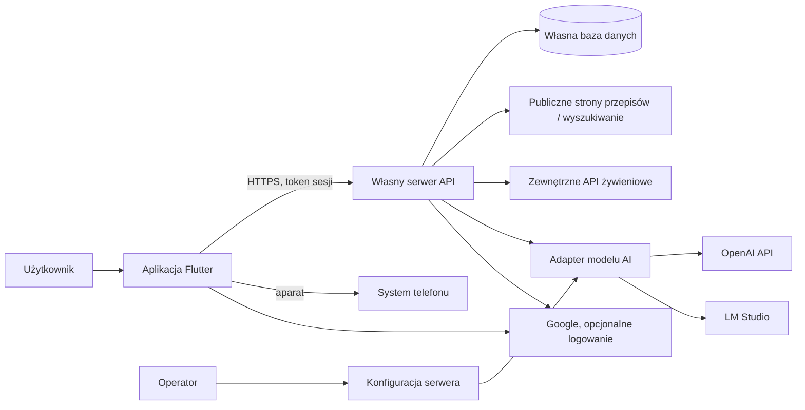

# Architektura docelowa aplikacji Miara

> Status: projekt do implementacji, aktualizacja 13 listopada 2026 r. Stan faktyczny: `app/` jest startowym projektem Flutter z ekranem licznika i testem szablonowym; `docs/prototyp-ui/` jest lokalną demonstracją interfejsu na danych przykładowych. W repozytorium nie ma jeszcze serwera, bazy danych ani integracji produkcyjnych. Docelowy backend to Python/FastAPI, baza PostgreSQL, wdrożenie on-premise, klient Android (ADR-009–010). Podstawowym źródłem przepisów jest AniaGotuje.pl (ADR-012).

## Cel i granice systemu

Miara pomaga użytkownikowi znaleźć przepis, oszacować jego wartości odżywcze, zaplanować posiłek i zapisać rzeczywiste spożycie. Zakres MVP określają [wymagania funkcjonalne](wymagania_funkcjonalne_i_przypadki_uzycia.md) RF-M01–RF-M21. Plan i dziennik są niezależnymi zbiorami. Wartości odżywcze są szacunkami z jawnych danych źródłowych. Brak danych pozostaje brakiem, a nie zerem. System nie wydaje diagnoz ani gwarancji bezpieczeństwa przy alergii.

Prototyp w `docs/prototyp-ui/` służy jako odniesienie dla nawigacji i języka interfejsu, lecz nie jest specyfikacją działania usług. Funkcje RF-R01–RF-R05 należą do etapu po MVP.

## Widok kontenerów

Operator wybiera **jednego** dostawcę modelu przy inicjalizacji serwera: OpenAI API albo LM Studio (RF-M21). Strzałki do obu dostawców pokazują alternatywy konfiguracji, nie równoczesne wywołanie ani automatyczny fallback. Dostawca modelu nie jest źródłem wartości odżywczych.

| Element | Odpowiedzialność | Poza odpowiedzialnością |
| --- | --- | --- |
| Aplikacja Flutter Android (`app/`) | Widoki, walidacja wejścia, aparat, potwierdzenie OCR, lokalna baza, trwała kolejka zmian, stany offline, synchronizacji i sesji | Przechowywanie kluczy do API żywieniowego lub modelu AI; autorytatywne wyliczenia |
| Własny serwer Python/FastAPI (do utworzenia) | Uwierzytelnianie i autoryzacja, pełny CRUD, orkiestracja integracji, obliczenia, ranking i audyt pochodzenia danych | Wymyślanie brakujących ilości lub wartości |
| Własna baza PostgreSQL (do utworzenia, on-premise) | Trwałe dane konta, profilu, planu i dziennika, wersje przepisu oraz metadane źródeł | Zastępowanie zewnętrznej bazy żywieniowej |
| Adapter źródeł przepisów | Wyszukiwanie, odczyt dozwolonych stron, normalizacja i deduplikacja | Bezwarunkowe kopiowanie pełnych stron |
| Adapter danych żywieniowych | Dopasowanie produktu i zapis jednostki, daty oraz źródła | Wnioskowanie o wartościach z samej nazwy potrawy |
| Adapter modelu AI | Ekstrakcja/normalizacja wymagająca modelu, propozycje zmian i uzasadnienia | Ostateczna decyzja o alergenach i rachunek makroskładników |

## Podział serwera na moduły

1. **Tożsamość i sesje** — rejestracja, logowanie hasłem lub Google, weryfikacja tokenu, wylogowanie i izolacja kont (RF-M01–M02).
2. **Profil** — CRUD celów, preferencji, wykluczeń i deklarowanych alergenów; walidacja zakresów (RF-M03).
3. **Odkrywanie przepisów** — kryteria niezależne od profilu, wyszukiwanie, deduplikacja, ekstrakcja i wersjonowanie źródła (RF-M04–M09).
4. **Dane żywieniowe i obliczenia** — dopasowanie produktu, przeliczenie ilości, sumy dla przepisu i porcji, kompletność oraz pochodzenie (RF-M10–M12).
5. **Dopasowanie i bezpieczeństwo wyniku** — ranking z wyjaśnieniem, wykryte wykluczenia i niepewność alergenów, obsługa braku wyników (RF-M13–M15).
6. **Plan i dziennik** — osobny CRUD i osobne sumy, zapis migawki wartości przy potwierdzeniu spożycia (RF-M16–M17, RF-M19).
7. **Etykieta produktu** — OCR jako szkic do poprawy i potwierdzenia przez użytkownika; nie tworzy wpisu automatycznie (RF-M18).
8. **Synchronizacja** — lokalny CRUD profilu, planu i dziennika, trwała kolejka i idempotentne wysyłanie, kontrola wersji, wybór użytkownika przy konflikcie oraz oznaczenie wieku danych i stanu synchronizacji (RF-M20).

Moduły mogą działać w jednym procesie serwera w MVP. Granice modułów i interfejsy adapterów powinny pozostać wyraźne, aby nie wiązać logiki domenowej z konkretnym dostawcą lub frameworkiem.

## Kluczowe przepływy

### Wyszukiwanie i oszacowanie

1. Aplikacja wysyła kryteria RF-M04; serwer waliduje je i tworzy żądanie wyszukiwania.
   Serwer od razu zwraca `202` i `search_id`. Zadanie trwa maksymalnie 5 minut. Klient obserwuje je krótkimi żądaniami; rozłączenie lub opuszczenie ekranu nie anuluje pracy. Stan i odnośniki do wyników są zachowane 30 dni od zakończenia.
2. Adapter pozyskuje strony z allowlisty, w pierwszej kolejności z podstawowego źródła `aniagotuje.pl` (ADR-012), zgodnie z warunkami i `robots.txt`; zapisuje URL, datę odczytu i minimalne metadane. Pełny tekst i zdjęcia nie są trwale kopiowane bez licencji/zgody lub potwierdzonej podstawy prawnej. Duplikaty są łączone po kanonicznym adresie i dozwolonych metadanych, bez ukrywania źródeł.
3. Agent wyodrębnia składniki, ilości, jednostki, porcje i ewentualnie proponuje zmianę. Każda propozycja zmian jest oddzielona od wersji źródłowej.
4. Adapter żywieniowy zwraca kandydatów do dopasowania. Niejednoznaczny wybór ma stan `requires_review`; brak ilości albo danych ma stan `missing`.
5. Deterministyczny kalkulator oblicza sumy tylko z dopasowanych składników i jawnych przeliczników. Wynik niespełniający warunków kompletności jest oznaczony jako częściowy.
6. Ranking porównuje wynik z profilem i kryteriami, wyjaśnia powody oraz nie nazywa przepisu „bezpiecznym” przy niepewnej informacji o alergenach.

### Plan i dziennik

Dodanie do planu zapisuje liczbę porcji, datę i wersję przepisu. Zmiana planu przelicza wyłącznie sumę planu. Potwierdzenie spożycia tworzy nowy wpis dziennika z faktyczną ilością i migawką wartości. Późniejsza edycja planu lub źródła przepisu nie zmienia historycznego wpisu dziennika. Edycja i usunięcie wpisu dziennika przeliczają wyłącznie sumę spożycia.

### OCR i tryb offline

Aparat dostarcza obraz etykiety. Miejsce wykonania OCR pozostaje do decyzji. Wynik OCR jest szkicem; użytkownik sprawdza wartość, jednostkę odniesienia i spożytą ilość przed zapisem. Przy braku sieci aplikacja pokazuje dostępne dane i czas synchronizacji oraz umożliwia zmiany profilu, planu i dziennika. Lokalny zapis i wpis do kolejki są atomowe; widok ma oznaczenie „Oczekuje na synchronizację”. Operacja serwerowa nie jest pozorowana jako zakończona.

Po odzyskaniu połączenia aplikacja odnawia dostęp do trwałej sesji i synchronizuje kolejkę zgodnie z zależnościami. Nie ma automatycznego wylogowania po czasie. Konflikt zachowuje lokalne zmiany i wymaga wyboru użytkownika; inne niezależne operacje są wykonywane dalej. Przy ręcznym wylogowaniu z niewysłanymi zmianami użytkownik wybiera synchronizację, powrót lub usunięcie zmian. Szczegóły cache, stanów widoków i ponowień określa [kontrakt API](kontrakt-api.md).

## Reguły przekrojowe

- Każdy zasób konta jest sprawdzany po stronie serwera na podstawie sesji; identyfikator właściciela z żądania klienta nie rozstrzyga dostępu.
- Komunikacja sieciowa używa TLS. Sekrety dostawców pozostają na serwerze; klient przechowuje token w bezpiecznym magazynie platformy. Logi nie zawierają haseł, tokenów, zdjęć etykiet ani pełnych danych profilu.
- Operacje sieciowe mają timeout, limit prób i jawny stan błędu. Ponowienie zapisu wymaga idempotencji lub kontroli wersji.
- Pochodzenie wartości jest częścią modelu danych i odpowiedzi API: źródło, czas pozyskania, jednostka odniesienia, kompletność, wersja przeliczenia.
- Przed wdrożeniem należy ustalić mierzalne budżety czasu odpowiedzi, kosztu wywołań i zużycia baterii/danych; nie ma jeszcze pomiarów uzasadniających konkretne progi.
- Zmiany kontraktów i danych idą przez migracje oraz testy zgodności. Odpowiedzi AI i strony WWW traktuje się jako dane niezaufane.

## Otwarte decyzje architektoniczne

Python/FastAPI, PostgreSQL, Android i źródło podstawowe zostały wybrane. [Ustalenia API i stanów klienta](ustalenia-api-i-stany.md) rozstrzygają format danych, przebieg wyszukiwania, trwałość sesji, offline z zapisami, konflikty i stany UI. Otwarte pozostają m.in. szczegóły środowiska, produkcyjne użycie źródeł, baza żywieniowa, reguły kalkulatora, OCR i pełna retencja/prywatność; wskazuje je [rejestr decyzji](decyzje-projektowe.md). Schematy, migracje i testy przyjętych reguł nadal wymagają implementacji.
