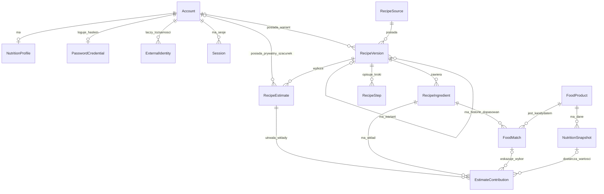
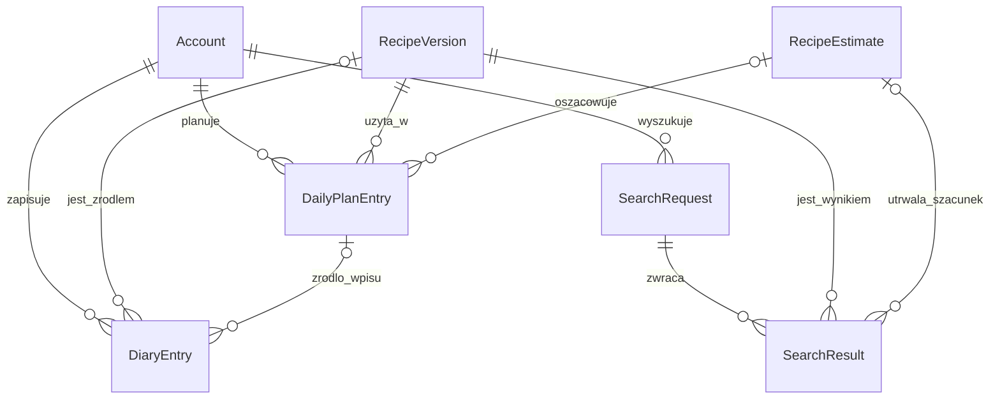

# Wstępny model danych Miary — v0.1

> Status: wstępny model logiczny v0.1 do przeglądu, 16 listopada 2026 r. Podstawa: [wymagania RF-M01–RF-M21](wymagania_funkcjonalne_i_przypadki_uzycia.md) i [ustalenia z 13 listopada](ustalenia-api-i-stany.md). Najpierw opracowujemy dane i reguły domeny; na ich podstawie powstaną formaty żądań i odpowiedzi oraz OpenAPI (ADR-014). PostgreSQL jest wybrany dla serwera, ale poniżej nie narzucamy ORM ani fizycznego układu tabel. Nie ma jeszcze migracji ani implementacji tych encji.

Właściciel zezwolił następnie na przejście do kontraktu na podstawie tego modelu (ADR-015, 16 listopada). [OpenAPI v0.1.0](api/openapi.json) konkretyzuje jego widoki i operacje. Doprecyzowania z etapu kontraktu to nazwa wpisu dziennika, jednokierunkowy ticket odwołania sesji oraz porządek zmian konta potrzebny do synchronizacji usunięć.

## Zakres wersji wstępnej

Model opisuje konto i profil, przepis z narzędzia LLM i jego warianty, dane żywieniowe i obliczenia, plan i dziennik oraz dane potrzebne do wyszukiwania i synchronizacji offline. Każda encja ma tożsamość, właściciela lub regułę współdzielenia, relacje i zasady zmiany/usunięcia. Obiekty wartości są częścią encji; nie każdy z nich wymaga osobnej tabeli.

Kolejność dalszej pracy: **przegląd modelu v0.1 → doprecyzowanie schematu bazy i klas domenowych → formaty komunikacji → OpenAPI**. Dotychczasowy [szkic API](kontrakt-api.md) służy jako materiał do późniejszego uzgodnienia z modelem. Nazwy pól modelu nie oznaczają, że wszystkie będą publicznymi polami API.

## Typy i zapis pól

| Zapis | Znaczenie |
| --- | --- |
| `id`, `*_id` | Własne identyfikatory UUID i odwołania do encji, chyba że wskazano identyfikator dostawcy. Nowy profil, plan i dziennik mogą otrzymać ID na urządzeniu. |
| `pole?` | Pole może być `null`. Brak pola ilościowego nie jest zerem. |
| Ilość, masa, kcal, makro | Liczba dziesiętna, logicznie `decimal`; precyzję kolumn ustalimy przy schemacie PostgreSQL. Zaokrąglenie następuje przy prezentacji. |
| `version` | Dodatnia liczba całkowita potwierdzona przez serwer, używana przy aktualizacji/usunięciu. Lokalna operacja utworzenia nie ma jeszcze wersji serwerowej. |
| `*_at`, `deadline_at` | Znacznik czasu UTC; lokalny dzień posiłku to osobne `local_date`. |
| `local_date`, `time_zone` | Data kalendarzowa wpisu oraz strefa konta. Zmiana strefy nie przenosi historycznych wpisów na inny dzień. |
| Lista | Kolekcja elementów; `[]` oznacza znany brak elementów. Gdy nie wiadomo, czy lista jest kompletna, zapisujemy osobny stan kompletności. |

## Zasady modelowania

- Dane użytkownika są oddzielone przez `account_id`; serwer ustala właściciela z sesji. Każda operacja odczytu i zapisu weryfikuje własność, także przez relacje pośrednie.
- `null` oznacza brak wiedzy; `0` oznacza zmierzone lub wyliczone zero. API nie zastępuje jednego drugim.
- Wartości liczbowe mają jednostkę i podstawę odniesienia. Dla danych żywieniowych przechowujemy źródło oraz datę pozyskania.
- Przepis źródłowy, propozycja zmian i zatwierdzona wersja to odrębne pojęcia. Wpis planu wskazuje konkretną wersję; dziennik przechowuje własną migawkę spożycia.
- Znaczniki `created_at`, `updated_at` i `version` służą do audytu oraz wykrywania konfliktów. Wszystkie znaczniki czasu są przechowywane w UTC, a data planu/dziennika odpowiada strefie wybranej dla konta.
- Zakres retencji i usuwania danych konta wymaga osobnej decyzji; referencje do źródeł zewnętrznych nie mogą uniemożliwiać usunięcia danych użytkownika.

## Encje

| Encja | Minimalne pola | Relacje i reguły |
| --- | --- | --- |
| `Account` | `id`, `email`, `created_at`, `status`, `time_zone` | Unikalny adres po normalizacji; konto może mieć hasło lub powiązaną tożsamość Google. Zasady weryfikacji adresu i usunięcia konta są otwarte. |
| `PasswordCredential` | `account_id`, `password_hash`, `updated_at` | Od zera do jednego poświadczenia hasłowego na konto; hash nie trafia do modelu klienta. |
| `ExternalIdentity` | `id`, `account_id`, `provider`, `provider_subject`, `created_at` | Konto może mieć wiele tożsamości. Para dostawca–identyfikator jest globalnie unikalna i wiązana dopiero po weryfikacji; sam zgodny email nie łączy kont. Dokładny przebieg łączenia pozostaje w ADR-106. |
| `Session` | `id`, `account_id`, skróty poświadczeń dostępu/odnowienia, `revocation_token_hash`, `access_expires_at`, `revoked_at`, metadane odwołania | Trwała sesja bez automatycznego wylogowania po czasie. Oddzielny token odwołania pozwala wyłącznie zakończyć tę sesję, nie uzyskać dostępu. Poświadczenie odnowienia nie ma stałego terminu wygaśnięcia, ale można je odwołać. |
| `NutritionProfile` | `id`, `account_id`, `daily_kcal_target`, opcjonalne cele makro, `meals_per_day`, preferencje, wykluczenia, alergeny, `version` | Jeden aktywny profil na konto w MVP. Cele dodatnie; lista alergenów to deklaracja użytkownika, a nie wynik diagnozy. Pełny CRUD RF-M03. |
| `RecipeSource` | `id`, `original_url`, `canonical_url`, `title`, `retrieved_at`, `source_domain`, `usage_status` | Bieżące metadane publicznego przepisu i URL do deduplikacji. Historyczny tytuł, URL i datę odczytu konkretnej wersji utrwala sama wersja. Zakres przechowywanej treści zależy od warunków źródła. |
| `RecipeVersion` | `id`, `source_id`, `title`, `parent_version_id?`, `created_by_account_id?`, `visibility`, `kind`, `servings?`, `total_mass_g?`, `prep_time_minutes?`, `cook_time_minutes?`, `ingredients_state`, `instructions_state`, `declared_nutrition?`, `missing_fields`, `changes`, `created_at`, `provenance` | Wersja źródłowa jest niemutowalna i może być współdzielona. Propozycja lub zatwierdzony wariant jest prywatny i ma właściciela. Nowa treść składników tworzy nową wersję. Deklaracja kcal z portalu jest odrębna od wyliczonego szacunku. |
| `RecipeIngredient` | `id`, `recipe_version_id`, `position`, `source_name`, `normalized_name?`, `quantity?`, `unit?`, `normalized_quantity?`, `normalized_unit?`, `conversion_basis?`, `review_state` | Składnik należy do jednej wersji; kolejność jest jawna. Ilość i jednostka mogą być nieznane. Konwersja do g/ml wymaga podstawy; tekst „do smaku” pozostaje nieoszacowany. |
| `RecipeStep` | `id`, `recipe_version_id`, `position`, `text` | Uporządkowane kroki danej wersji; nie mają własnego cyklu życia poza przepisem. Zakres zapisanej treści nadal wynika z warunków źródła. |
| `FoodProduct` | `id`, `provider`, `provider_product_id`, `name`, `variant?` | Tożsamość produktu z wybranej w przyszłości bazy. Unikalna para dostawca–ID; nazwa sama nie identyfikuje produktu ani wariantu surowy/gotowany. |
| `FoodMatch` | `id`, `ingredient_id`, `food_product_id`, `created_by_account_id?`, `confidence_state`, `selected_by`, `selected_at` | Historia kandydatów i wyborów, nie jeden nadpisywany rekord. W konkretnym wyliczeniu używa się co najwyżej jednego dopasowania na składnik. Wybór użytkownika jest prywatny; nowy wybór nie zmienia wcześniejszego szacunku. |
| `NutritionSnapshot` | `id`, `food_product_id`, `retrieved_at`, `per_amount`, `per_unit`, `values`, `source_reference` | Niemutowalna migawka danych produktu. `per_amount` jest dodatnie, `values` zawiera kcal i makro z dopuszczalnymi brakami. Retencja cache dostawcy nadal wynika z ADR-104/111. |
| `RecipeEstimate` | `id`, `recipe_version_id`, `account_id?`, `visibility`, `calculation_version`, `total_values`, `per_serving_values?`, `completeness`, `missing`, `calculated_at` | Niemutowalny wynik konkretnego wyliczenia. Szacunek używający prywatnego wariantu lub wyboru użytkownika jest prywatny i ma właściciela, także gdy sam przepis źródłowy jest współdzielony. Nowa wersja danych lub dopasowania tworzy nowy szacunek. |
| `EstimateContribution` | `id`, `estimate_id`, `ingredient_id`, `food_match_id?`, `nutrition_snapshot_id?`, `used_quantity?`, `conversion_basis?`, `values`, `missing` | Wkład jednego składnika do danego szacunku, także pominiętego. Utrwala, jakie dopasowanie, migawkę i przelicznik faktycznie użyto, zamiast odwoływać się do później zmienionego „bieżącego” wyboru. |
| `SearchRequest` | `id`, `account_id`, `criteria`, `profile_snapshot?`, `status`, `created_at`, `deadline_at`, `finished_at?`, `expires_at?`, `warnings`, `error?` | Zadanie z limitem 5 minut. Kryteria zapytania i użyty profil są rozdzielone; późniejsza edycja profilu nie zmienia powodów historycznego rankingu. Stan i wyniki są zachowane 30 dni od zakończenia. |
| `SearchResult` | `id`, `search_request_id`, `recipe_version_id`, `recipe_estimate_id?`, `position`, `match_status`, `reasons`, `warnings` | Element listy wskazujący konkretną wersję i szacunek z momentu wyszukiwania. Wersja może występować w wielu wyszukiwaniach; usunięcie historii zadania nie usuwa przepisu potrzebnego do wpisów. |
| `DailyPlanEntry` | `id`, `account_id`, `local_date`, `recipe_version_id`, `recipe_estimate_id?`, `servings`, `estimate_snapshot`, `version` | Pełny CRUD RF-M16/M19. Liczba zaplanowanych porcji jest dodatnia; nieznana wydajność przepisu oznacza brak wiarygodnego wyniku na porcję, a nie blokadę samego zapisania planu. Suma planu obejmuje tylko plan. |
| `DiaryEntry` | `id`, `account_id`, `local_date`, `display_name`, `origin`, `plan_entry_id?`, `recipe_version_id?`, `consumed_quantity`, `nutrition_snapshot`, `version` | Pełny CRUD RF-M17/M19. `origin`: `plan`, `manual` lub `label`. Faktyczna ilość jest dodatnia; wpis ma własną nazwę i migawkę. Usunięcie planu zeruje opcjonalne powiązanie, ale nie kasuje ani nie przelicza dziennika. |
| `LabelDraft` | `id?`, `account_id?`, odczytane pola, `reference_amount`, `reference_unit`, stan korekty | Szkic może pozostać tylko na urządzeniu. Nie staje się `DiaryEntry` bez potwierdzenia użytkownika. Decyzja o wysyłaniu i przechowywaniu zdjęcia jest otwarta. |
| `LocalOperation` (telefon) | `operation_id`, `account_id`, `resource_type`, `resource_id`, `action`, `payload`, `base_version?`, `depends_on`, `state`, `attempts`, `created_at`, `last_error?` | Trwała kolejka operacji `create`, `update`, `delete` dla profilu, planu i dziennika. `depends_on` jest listą identyfikatorów wcześniejszych operacji. Zapis do kolejki i zmiana lokalnego widoku są jedną transakcją. Restart i błąd sieci nie usuwają operacji. |
| `LocalResourceState` (telefon) | `account_id`, `resource_type`, `resource_id`, `base_version?`, `latest_server_version?`, `base_value?`, `server_value?`, `local_value?`, `last_synced_at?`, `sync_state`, `is_deleted` | Zachowuje bazę lokalnej edycji, ostatni pobrany stan serwera oraz lokalny stan z oczekującymi zmianami/usunięciem. `sync_state`: `synced`, `pending`, `syncing`, `conflict`, `error`. |
| `OperationReceipt` (serwer) | `account_id`, `operation_id`, `resource_type`, `resource_id`, `action`, `payload_hash`, `result_version?`, `applied_at` | Atomowe potwierdzenie zmiany domenowej i deduplikacja. Ten sam identyfikator z inną treścią jest odrzucany. Mapowanie operacji na metody HTTP powstanie przy kontrakcie API. |
| `ResourceDeletion` (serwer) | `account_id`, `resource_type`, `resource_id`, `version`, `deleted_at` | Znacznik usunięcia profilu lub wpisu. Pozwala rozpoznać usunięty zasób przy synchronizacji i odróżnić go od nowego ID; stare żądanie nie może odtworzyć go bez wyboru użytkownika. |
| `AccountChange` (serwer) | `account_id`, `sequence`, `resource_type`, `resource_id`, `version`, `action`, `resource_snapshot?`, `recorded_at` | Porządek zmian profilu/planu/dziennika. Monotoniczna sekwencja per konto, `upsert` z migawką wersji albo `delete`. Zapis zmiany, potwierdzenie operacji i aktualizacja zasobu są atomowe. Publiczny kursor nie ujawnia surowej sekwencji i nie opiera się wyłącznie na czasie. |

## Wspólne obiekty wartości

| Obiekt | Pola i reguły |
| --- | --- |
| `Quantity` | `amount: decimal`, `unit: string`; dla spożycia ilość jest dodatnia. Jednostka źródłowa może być domowa; nie implikuje automatycznego przelicznika do g/ml. |
| `NutrientValues` | `kcal`, `protein_g`, `carbohydrate_g`, `fat_g`: nieujemne liczby dziesiętne lub `null`. Jednostka i ilość odniesienia są zapisane w obiekcie nadrzędnym. |
| `NutritionReference` | `per_amount`, `per_unit`, `values: NutrientValues`, `source_reference`. Używany m.in. dla deklarowanych wartości portalu; „100 g” i „1 porcja” nie są zamienne. |
| `SourceReference` | `kind`, `url?`, `provider?`, `provider_product_id?`, `retrieved_at?`, `display_name?`; rozróżnia stronę przepisu, bazę żywieniową, etykietę i wpis ręczny. Model LLM nie jest źródłem wartości odżywczych. |
| `RecipeProvenance` | URL i data odczytu wersji źródłowej, nazwa/wersja ekstraktora i odwołanie do rodzica przy wariancie. `RecipeVersion.provenance` zachowuje te dane niezależnie od późniejszego odświeżenia `RecipeSource`. |
| `Completeness` | Stan każdej wielkości oraz stanu łącznego: `complete`, `partial`, `missing`. Stan łączny nie ukrywa braku pojedynczego makroskładnika. |
| `MissingData` | `field`, `ingredient_id?`, `reason`; wskazuje np. brak ilości, przelicznika, dopasowania, porcji albo konkretnego makroskładnika. |
| `MealNutritionSnapshot` | Własna kopia `quantity`, `values`, `completeness`, `missing`, `sources`, `recipe_version_id?`, `recipe_estimate_id?`, `calculation_version?`, `captured_at`. Wartości dotyczą zapisanej ilości posiłku. Plan i dziennik mają osobne kopie; nie wskazują wspólnego nadpisywanego obiektu. |
| `SearchCriteria` | `dish_name?`, `max_time_minutes?`, `max_ingredients?`, opcjonalne zakresy kcal i makro na porcję. Puste kryterium nie filtruje; dolna granica nie przekracza górnej. |
| `SessionRevocationTicket` (telefon) | `session_id`, token odwołania w bezpiecznym magazynie, `queued_at`. Po wylogowaniu offline może przetrwać wyłącznie poświadczenie odwołania; tokeny umożliwiające odczyt/odnowienie są usuwane. Ticket nie daje dostępu do danych i nie jest operacją CRUD profilu/planu/dziennika. |

`DailyPlanEntry.estimate_snapshot` i `DiaryEntry.nutrition_snapshot` mają typ `MealNutritionSnapshot`. Migawka produktu `NutritionSnapshot` przechowuje natomiast dane na ilość odniesienia z bazy żywieniowej. Rozdzielenie tych pojęć zapobiega pomyleniu wartości np. na 100 g z sumą zjedzonego posiłku.

## Relacje konta, przepisów i obliczeń

Opcjonalny właściciel `RecipeVersion` dotyczy wyłącznie wersji źródłowej współdzielonej. Wersja prywatna zawsze ma właściciela. Każde `EstimateContribution` dotyczy składnika z tej samej wersji co jego `RecipeEstimate`; wybrane dopasowanie i migawka muszą dotyczyć tego samego produktu.

## Relacje planu, dziennika i wyszukiwania

Jeden wpis planu może być źródłem kilku wpisów dziennika, np. gdy posiłek zjedzono w dwóch częściach. Zapis planu sam nie tworzy dziennika. Brakujące relacje do przepisu we wpisie ręcznym lub z etykiety są prawidłowe, a dane o spożyciu pozostają w migawce.

## Ograniczenia i proponowane stany

- Jedno aktywne `NutritionProfile` na konto; znormalizowany email konta jest unikalny. Preferencje, wykluczenia i deklarowane alergeny są na razie listami; docelowe słowniki wynikną z ADR-109.
- `RecipeSource.canonical_url` jest unikalny. `RecipeVersion.kind`: `source`, `proposal`, `approved`; `visibility`: `shared`, `private`. Propozycja i zatwierdzony wariant mają prywatnego właściciela.
- W obrębie wersji przepisu kolejność składników i kroków jest unikalna. `ingredients_state` i `instructions_state` używają `complete`, `partial`, `missing`; brak rekordów nie oznacza automatycznie kompletnej pustej listy.
- `FoodMatch.confidence_state`: `matched`, `requires_review`. Brak kandydatów oznacza brak rekordów dopasowania i stan `missing` w `RecipeIngredient.review_state`. `selected_by` wskazuje użytkownika albo regułę/adapter; kandydat bez zatwierdzonego dopasowania nie staje się pewnym źródłem wartości.
- Unikalny wkład `(estimate_id, ingredient_id)`. Dopasowanie, migawka i ilość użyte we wkładzie są historyczne; ponowny rachunek tworzy inny `RecipeEstimate`.
- Szacunek wskazany w planie lub wyniku wyszukiwania musi dotyczyć tej samej wersji przepisu co wpis/wynik. Migawka przechowuje identyfikatory faktycznie użytego przepisu i szacunku.
- Do planu trafia wersja źródłowa albo zatwierdzona (`approved`); propozycja zmian wymaga wcześniejszego zatwierdzenia. Podanie samego ID propozycji nie omija tego warunku.
- `SearchRequest.status`: `pending`, `running`, `completed`, `partial`, `failed`, `cancelling`, `cancelled`. `partial` wyszukiwania i niepełność wartości odżywczych są niezależne.
- Unikalny wynik `(search_request_id, recipe_version_id)`; wynik zachowuje uzasadnienia z chwili wyszukiwania.
- `LocalOperation` i `OperationReceipt` są unikalne po `(account_id, operation_id)`. `LocalResourceState` oraz `ResourceDeletion` po `(account_id, resource_type, resource_id)`.
- Proponowane stany kolejki: `queued`, `sending`, `applied`, `conflict`, `rejected`. Błąd przejściowy wraca do `queued` z zapisaną przyczyną; `rejected` wymaga poprawy danych. Stan `sending` po restarcie wymaga sprawdzenia/ponowienia tej samej operacji.
- Odwołanie do profilu, planu, dziennika lub wariantu prywatnego zawsze musi wskazywać zasób tego samego konta. FK do istniejącego ID nie zastępuje sprawdzenia właściciela.
- Prywatny `FoodMatch` może być użyty tylko przez szacunek tego samego właściciela. Prywatny `RecipeEstimate`, jego wkłady i powiązania w wynikach wyszukiwania również wymagają izolacji kont; współdzielony przepis nie upublicznia tych danych.

## Jednostki i rachunek

Wewnętrzna ilość składnika dla obliczenia powinna być wyrażona w g lub ml wraz z regułą przeliczenia. Wartość składnika dla danej wielkości to `wartość_na_jednostkę_źródła × ilość_po_przeliczeniu / ilość_odniesienia`. Suma przepisu obejmuje tylko składniki z poprawną ilością i daną wielkością; wartość na porcję to suma podzielona przez dodatnią liczbę porcji. Zaokrąglenie stosuje się na wyjściu, po sumowaniu. Dla każdej wielkości (kcal, białko, węglowodany, tłuszcz) kompletność liczy się oddzielnie, aby brak jednego makroskładnika nie udawał pełnego wyniku.

Nieznane jednostki domowe, masa po obróbce, straty technologiczne i produkty o wielu wariantach wymagają reguł opisanych w decyzjach projektowych. Bez wiarygodnego przelicznika składnik trafia na listę braków. Wartość „0 kcal” wymaga zewnętrznej danej równej zero; sam brak dopasowania nie wystarcza.

## Spójność, wersjonowanie i kasowanie

- Zmiana treści składnika, jego ilości lub kroków tworzy nowy `RecipeVersion` wraz z własnymi składnikami/krokami. Zmiana wyboru produktu bez zmiany przepisu tworzy nowy `FoodMatch` i `RecipeEstimate`, zachowując poprzednie wybory we wkładach. Zatwierdzona treść i istniejące migawki nie są nadpisywane.
- Dostęp do prywatnej `RecipeVersion` oraz jej składników, dopasowań, szacunków i wyników wyszukiwania wymaga kontroli `created_by_account_id` na serwerze. Samo posiadanie ID wariantu nie uprawnia do odczytu. Współdzielona wersja źródłowa nie może zawierać prywatnych zmian ani danych profilu.
- Profil, plan i dziennik mają wersję do aktualizacji warunkowej. Przy konflikcie klient zachowuje lokalne zmiany, pobiera aktualny stan i prosi użytkownika o wybór. Pozostałe niezależne operacje synchronizują się dalej.
- Dziennik zapisuje migawkę wartości z momentu potwierdzenia, aby późniejsza aktualizacja API żywieniowego nie zmieniła historii bez wiedzy użytkownika.
- Usunięcie wpisu planu nie usuwa powiązanego wpisu dziennika. Usunięcie konta powinno obejmować dane osobowe oraz szkice etykiet zgodnie z ustaloną retencją.
- Usunięcie historii wyszukiwania usuwa jego `SearchResult`, ale nie jest kaskadą do `RecipeVersion` ani `RecipeEstimate`. Wersje wykorzystywane przez plan/dziennik pozostają dostępne w dozwolonym zakresie, a migawki wpisów są samodzielne.
- Wyników dziennych nie traktujemy jako osobnych edytowalnych encji. Suma planu i suma spożycia to dwa odrębne odczyty wyliczane z odpowiednich wpisów i ich migawek, z zachowaniem niepełności.
- Unikalność po stronie serwera powinna zapobiegać zduplikowaniu wpisu przy ponowieniu żądania. Służy temu klucz idempotencji lub równoważny mechanizm.
- Zastosowanie zmiany i zapis `OperationReceipt` są jedną transakcją serwera. Otrzymanie odpowiedzi nie wystarcza do usunięcia lokalnej operacji: najpierw trzeba trwale uzgodnić lokalne dane i wersję, zachowując działanie zależnych operacji.
- Ta sama transakcja publikuje `AccountChange`, także dla zmiany powiązania w dzienniku po usunięciu planu. Wtedy wzrasta wersja wpisu dziennika, lecz jego migawka i suma nie zmieniają się. Spójny odczyt początkowy i przyrost po sekwencji nie mogą zgubić zmian wykonanych między stronami.

## Lokalny zapis i synchronizacja

- Nowe zasoby profilu, planu i dziennika otrzymują UUID na urządzeniu; serwer zachowuje identyfikator i sprawdza właściciela. Nie używamy tymczasowego indeksu listy jako identyfikatora.
- Offline działa CRUD profilu, planu i dziennika na dostępnych danych. Nowe wyszukiwanie LLM i serwerowe przetwarzanie wymagają sieci. Rejestracja i pierwsze logowanie wymagają połączenia.
- Każda zmiana ma osobny, niezmienny `operation_id`; zależne zmiany są wysyłane w kolejności. Edycja oczekującego wpisu nie gubi jego operacji utworzenia.
- Zależności operacji należą do tego samego konta i nie tworzą cykli. Operacja edycji wpisu utworzonego offline uzyska potwierdzoną wersję bazową dopiero po zastosowaniu operacji utworzenia; jej wysyłana treść jest następnie stała we wszystkich ponowieniach.
- Pobranie serwerowej wersji nie nadpisuje lokalnych oczekujących zmian ani znacznika usunięcia. Widok i sumy uwzględniają lokalne operacje, a po synchronizacji są uzgadniane z autorytatywną odpowiedzią serwera.
- Powiązany wpis dziennika może powstać offline z lokalnego wpisu planu; operacja utworzenia planu jest wtedy zależnością. Zachowujemy odrębną migawkę spożycia.
- Błąd walidacji zachowuje operację do poprawy, konflikt wymaga wyboru, a błąd sieci pozostawia ją do ponowienia. Nowa treść poprawionej operacji otrzymuje nowy identyfikator; nie podmieniamy treści żądania, którego wynik jest nieznany.
- Cache obejmuje profil, pobrane wpisy planu/dziennika oraz ostatnie wyniki i otwarte przepisy. Dane konta pozostają do wylogowania. Podręczne przepisy i wyniki można usuwać po 30 dniach, jeśli nie są potrzebne do wpisów lub kolejki.
- Wylogowanie z niewysłanymi zmianami wymaga wyboru synchronizacji, powrotu lub wylogowania z ich usunięciem. Odwołanie sesji wstrzymuje wysyłanie i dostęp do danych konta, lecz nie kasuje po cichu niewysłanych zmian; wznowienie jest możliwe po logowaniu na to samo konto. Konto B nie widzi kolejki konta A.

## Macierz CRUD wymagane na zaliczenie

| Zbiór | Create | Read | Update | Delete | Wymagania |
| --- | --- | --- | --- | --- | --- |
| Profil | Utworzenie po logowaniu | Odczyt własnego | Zmiana celów i ograniczeń | Usunięcie profilu | RF-M03, RF-M19 |
| Plan | Dodanie przepisu i porcji | Widok dnia i sumy | Data/porcja/wariant | Usunięcie wpisu | RF-M16, RF-M19 |
| Dziennik | Potwierdzenie spożycia lub wpis ręczny | Widok dnia i sumy | Korekta faktycznej ilości | Usunięcie wpisu | RF-M17, RF-M19 |

Weryfikacja każdego pola macierzy powinna obejmować trwałość po ponownym pobraniu, izolację kont i aktualizację sum. Szczegóły żądań określa [kontrakt API](kontrakt-api.md).

## Sprawdzenie modelu na przepływach MVP

Poniżej jest przegląd logiczny, a nie raport z wykonanych testów aplikacji lub bazy.

| Przypadek | Jakie dane powstają lub są używane | Co ma pozostać prawdą |
| --- | --- | --- |
| Narzędzie LLM odczytuje przepis | `RecipeSource` → `RecipeVersion` → składniki/kroki; `SearchResult` wskazuje wersję. | Model domenowy dostaje zweryfikowane informacje; brak ilości lub instrukcji pozostaje jawny, bez zachowywania dowolnej surowej odpowiedzi LLM jako przepisu. |
| Kalkulator szacuje wartości | `FoodProduct`, `FoodMatch`, `NutritionSnapshot`, `RecipeEstimate` i jego `EstimateContribution`. | Da się wskazać dokładne źródło i ilość dla każdego wkładu, także po późniejszej zmianie dopasowania. |
| Użytkownik zmienia ilość składnika | Nowa wersja przepisu z powiązaniem do rodzica i nowym szacunkiem. | Istniejące wpisy planu nie przeskakują na nowszą wersję automatycznie. |
| Posiłek trafia do planu, potem do dziennika | `DailyPlanEntry` ze swoją migawką; po potwierdzeniu nowy `DiaryEntry` z faktyczną ilością i odrębną migawką. | Plan i dziennik mają osobne sumy; zmiana lub usunięcie planu nie zmienia historii spożycia. |
| Użytkownik skanuje etykietę | `LabelDraft` → korekta i potwierdzenie → `DiaryEntry` z `origin=label`. | Dziennik nie wymaga fikcyjnego przepisu ani produktu z zewnętrznej bazy. |
| Offline powstaje plan i wpis spożycia | Lokalne UUID, dwa wpisy i `LocalOperation` z zależnością utworzenia dziennika od utworzenia planu. | Restart nie gubi zmian; synchronizacja zachowuje ID i kolejność zależności. |
| Odpowiedź po zapisie ginie | `OperationReceipt` istnieje wraz z zastosowaną zmianą; lokalna operacja zachowuje ID. | Ponowienie odczytuje wynik zastosowania, nie tworzy drugiego wpisu. |
| Drugie urządzenie usuwa lub zmienia wpis | Zmienia się `version` albo istnieje `ResourceDeletion`; telefon zachowuje wersję bazową i lokalną. | Konflikt wymaga wyboru; odświeżenie nie usuwa lokalnych zmian i nie odtwarza automatycznie skasowanego wpisu. |

## Co doprecyzujemy po przeglądzie v0.1

- Wartości i stany techniczne powyżej są propozycją modelu v0.1; wcześniejsze wybory dotyczące offline, sesji, konfliktów i limitu wyszukiwania pozostają przyjęte.
- **Schemat fizyczny:** precyzje liczb, tabele/kolumny lub osadzone obiekty, indeksy, migracje i lokalny silnik danych. Nie trzeba wybierać ich, aby sprawdzić relacje domenowe.
- **Źródła i rachunek:** dostawca danych produktów, słownik jednostek, przeliczniki i zaokrąglanie pozostają w ADR-104–105. Tożsamość produktu i migawki nie zależą od wyboru dostawcy.
- **Konto i słowniki:** przebieg rejestracji i łączenia tożsamości (ADR-106), słownik alergenów/wykluczeń (ADR-109). Model zachowuje izolację kont i nie interpretuje pustych danych jako potwierdzenia zgodności.
- **OCR i retencja:** miejsce OCR i los zdjęcia (ADR-107), pełna retencja danych, potwierdzeń operacji i znaczników usunięcia (ADR-111). Ustalone 30 dni historii wyszukiwania nie oznacza 30 dni życia danych planu/dziennika.
- **Komunikacja:** przygotowano [kontrakt v0.1.0](kontrakt-api.md) i [OpenAPI](api/openapi.json). DTO nie udostępniają hashy poświadczeń ani całych wewnętrznych encji synchronizacji serwera. Testy pliku kontraktu nie zastępują implementacji modelu, bazy i autoryzacji.
